

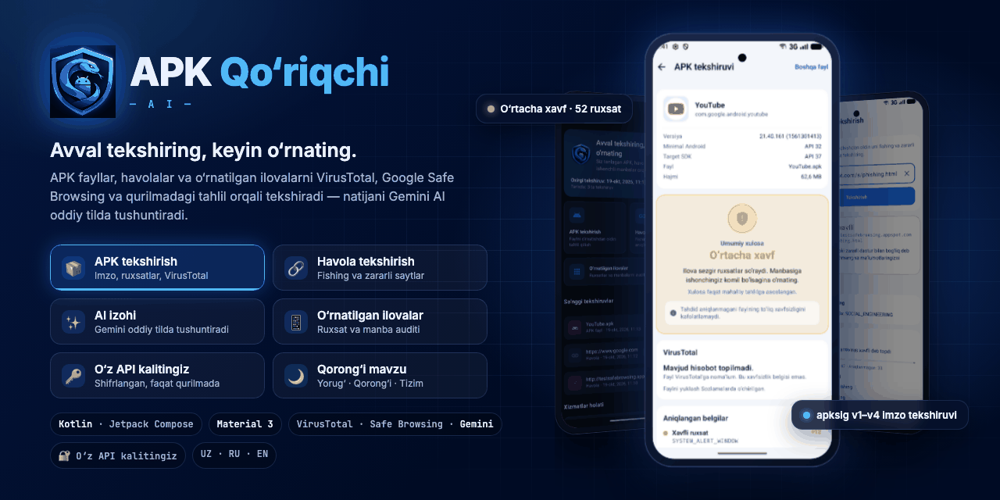

# APK Qo‘riqchi AI — skrinshotlar

Interaktiv banner: [`banner/banner.html`](banner/banner.html) (brauzerda oching; ← → tugmalari, bosish va sichqoncha bilan boshqariladi).
Statik banner: [`banner/banner.png`](banner/banner.png) · Animatsiya: [`banner/banner.gif`](banner/banner.gif)

## Boshlash va bosh sahifa

| Onboarding | Maxfiylik | Bosh sahifa (kalitsiz) | Bosh sahifa |
|:-:|:-:|:-:|:-:|
| 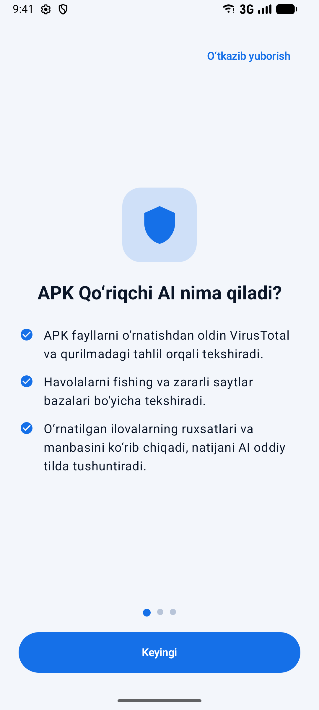 | 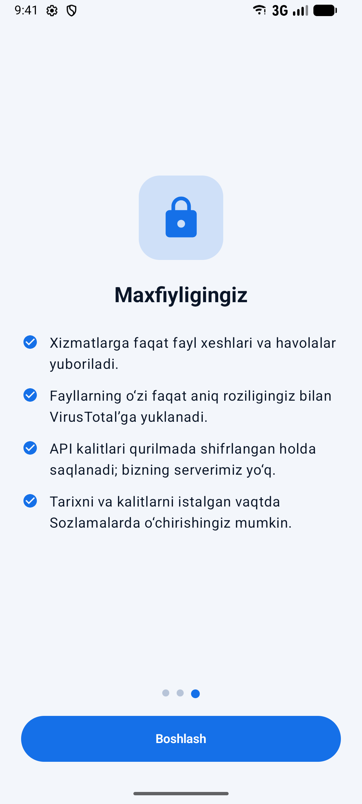 | 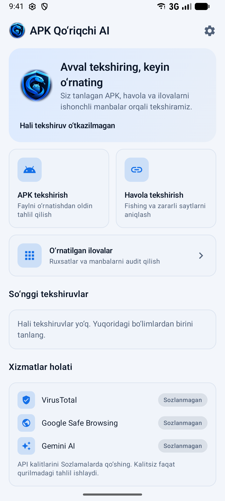 | 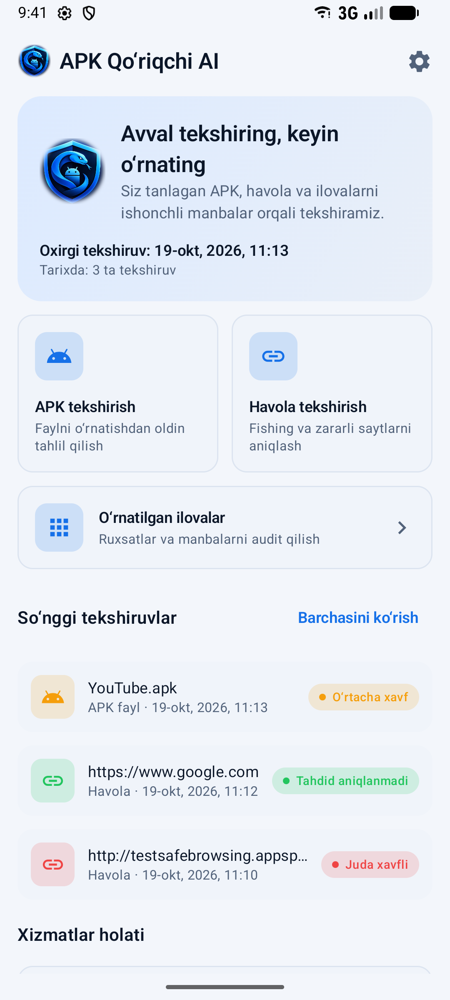 |

## O‘z API kalitingiz

Ilovada tayyor kalitlar yo‘q: har bir foydalanuvchi o‘z bepul kalitlarini **Sozlamalar → API kalitlari** bo‘limida kiritadi. Kalitlar qurilmada shifrlangan holda (Android Keystore) saqlanadi.

| Kalit kiritish va yo‘riqnoma | Kalitlar saqlangan va tekshirilgan |
|:-:|:-:|
| 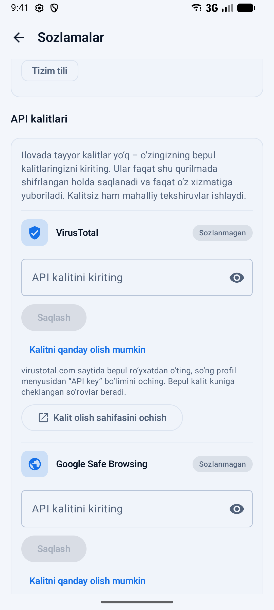 | 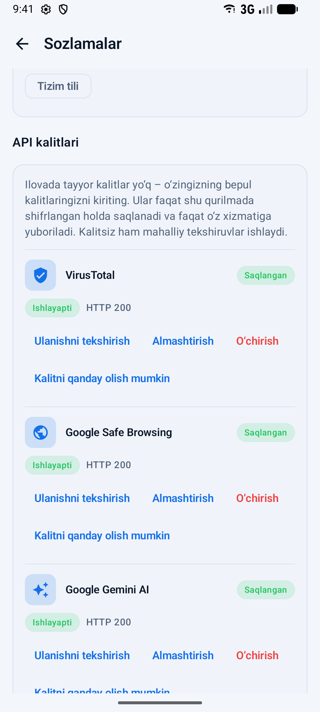 |

## Havola tekshirish va AI izohi

| Fishing havola | Xavfsiz havola | Gemini AI izohi |
|:-:|:-:|:-:|
| 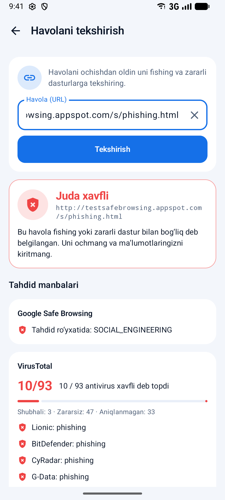 | 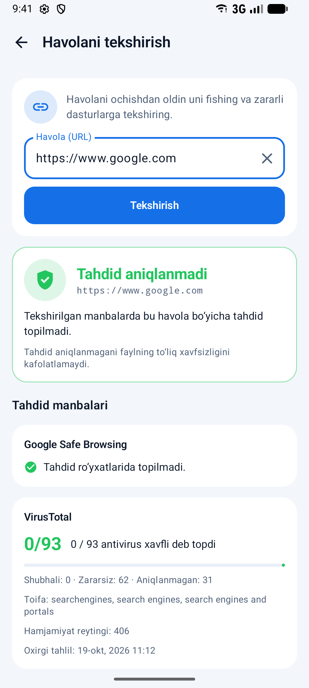 | 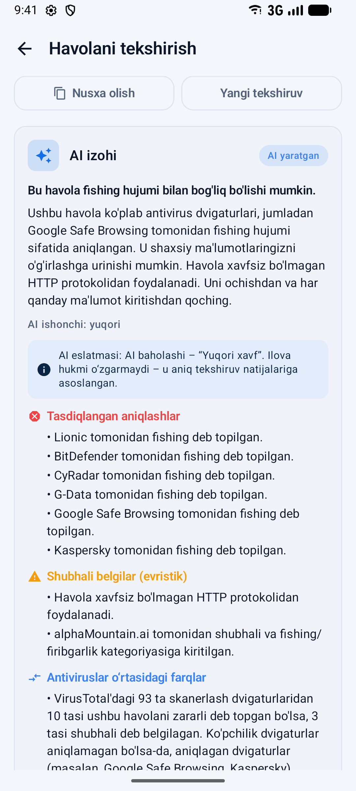 |

## APK tekshirish

| Fayl tanlash | Hisobot | Aniqlangan belgilar |
|:-:|:-:|:-:|
| 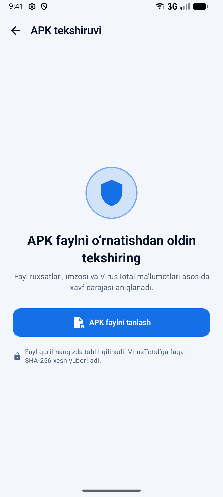 | 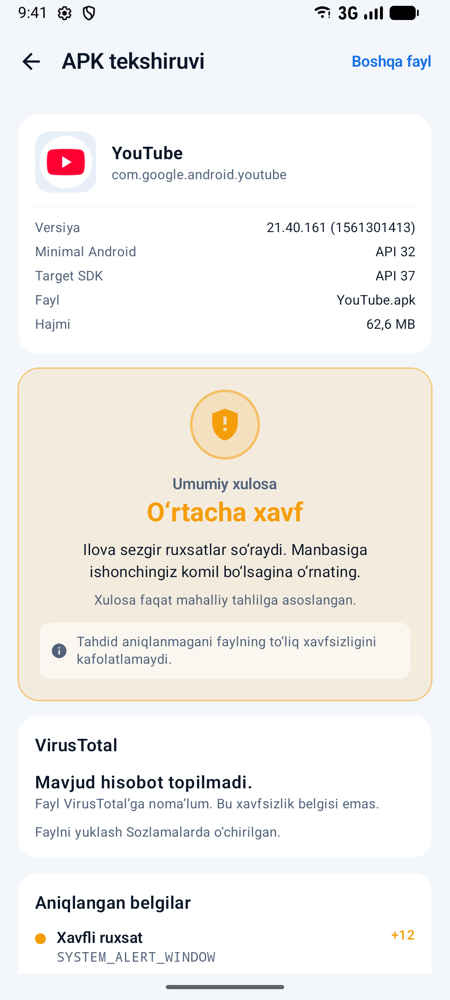 | 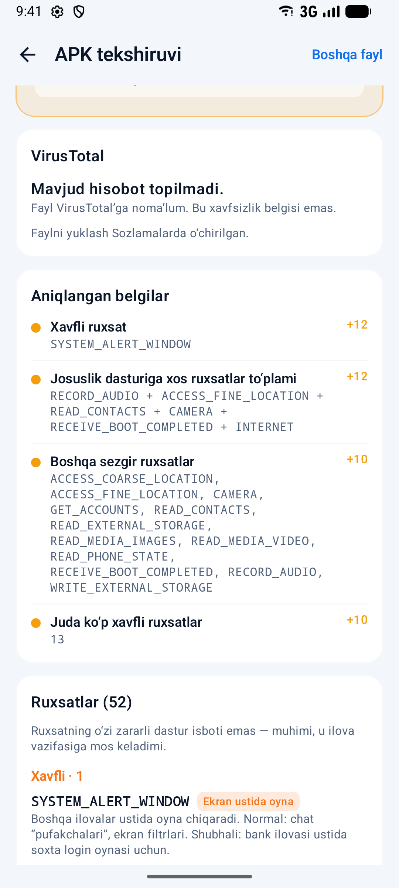 |

## O‘rnatilgan ilovalar, tarix va qorong‘i mavzu

| Ilovalar auditi | Tarix | Qorong‘i mavzu | Sozlamalar (qorong‘i) |
|:-:|:-:|:-:|:-:|
| 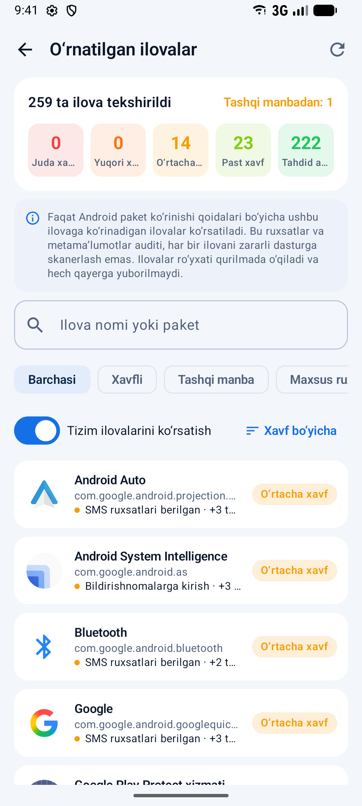 | 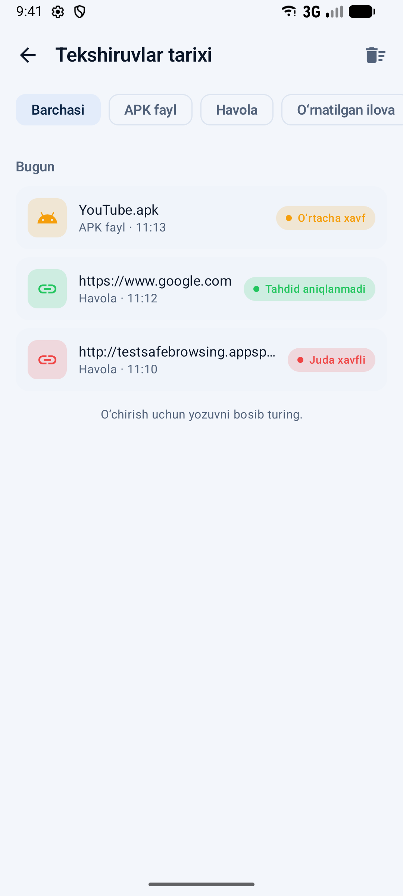 | 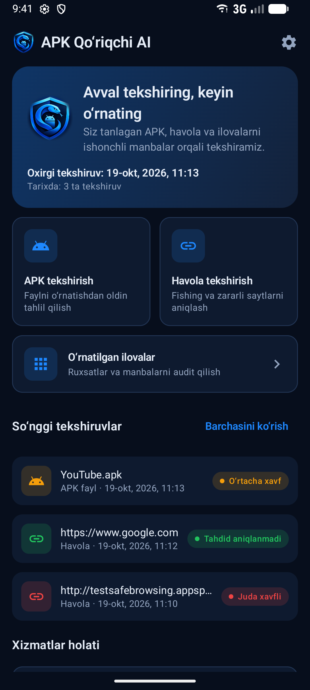 | 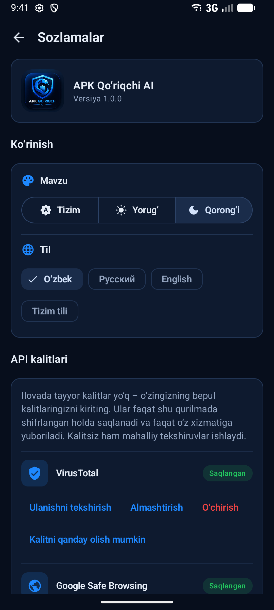 |
